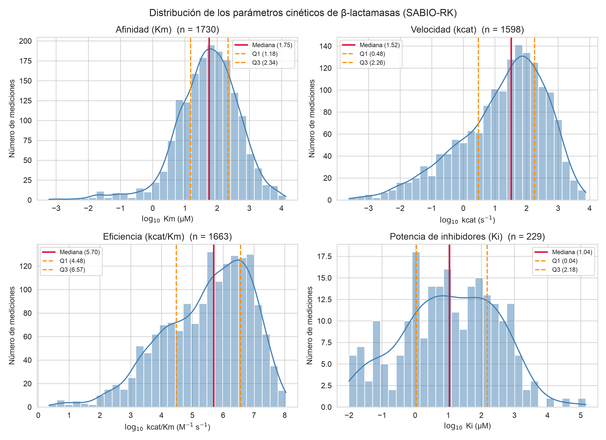
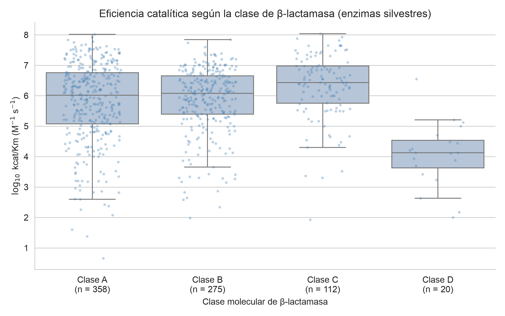
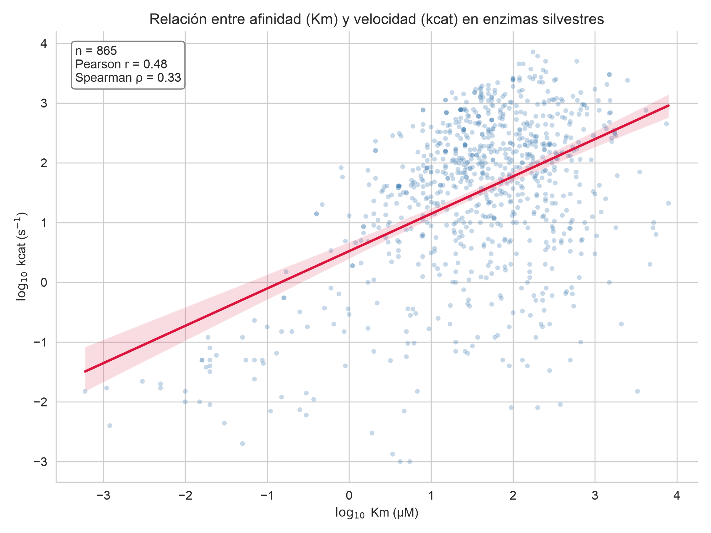
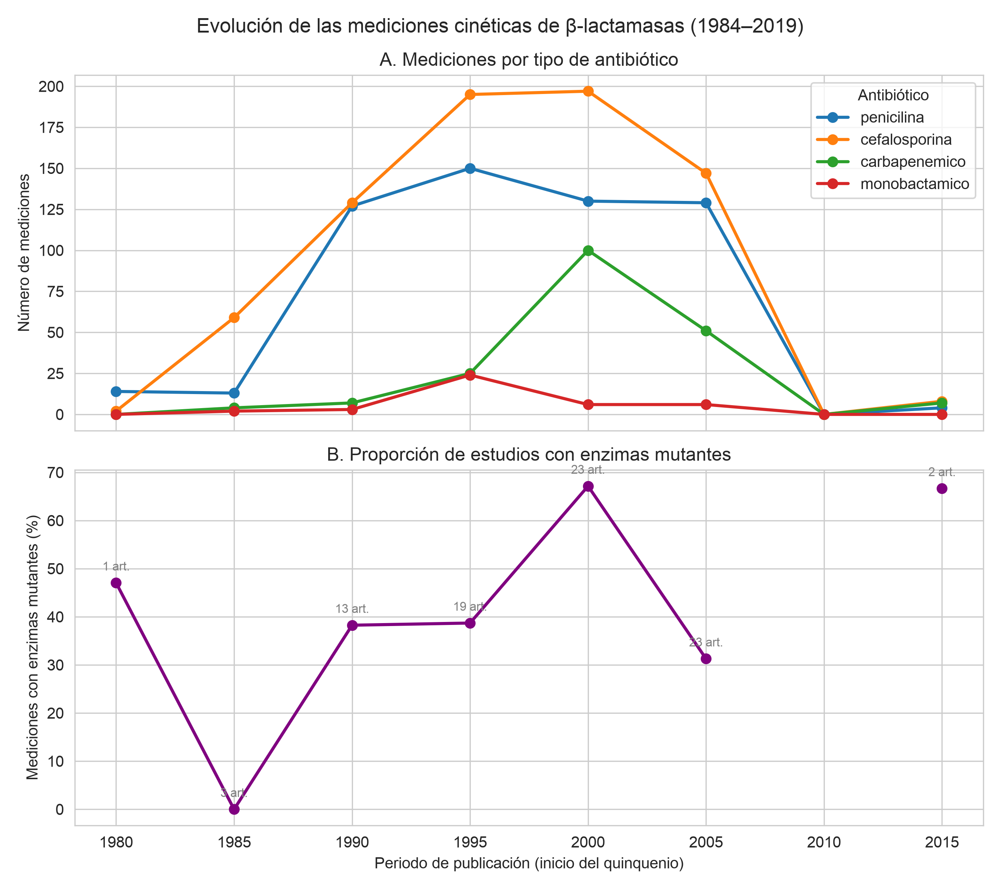
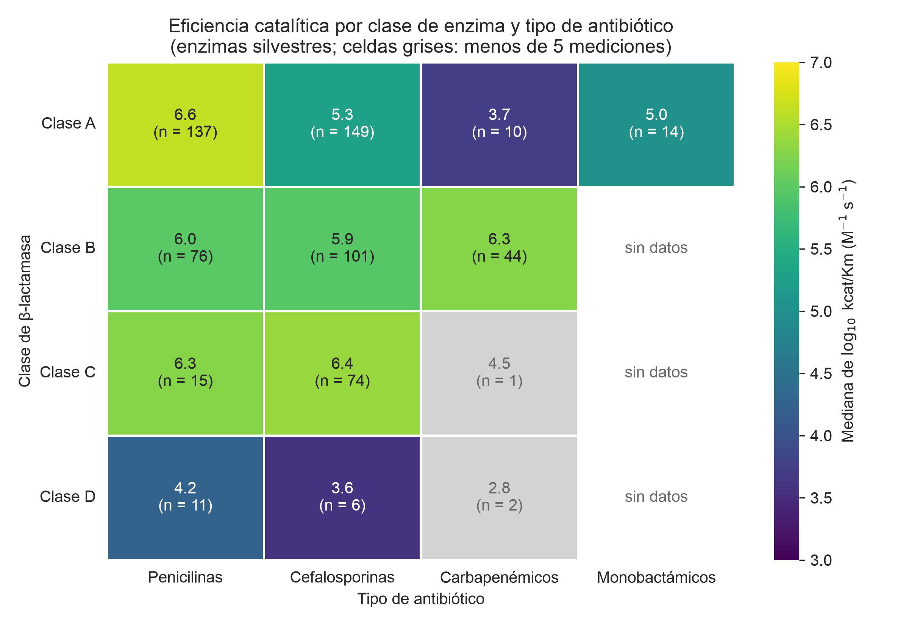

# EDA_Python: cinética de β-lactamasas

Análisis exploratorio de datos (EDA) con Python sobre parámetros cinéticos de **β-lactamasas**, las enzimas con las que las bacterias destruyen la penicilina y sus derivados. El trabajo va desde la descarga y limpieza de los datos hasta la comunicación de los hallazgos con gráficos.

## De qué trata

Las β-lactamasas son una de las principales causas de resistencia a antibióticos. Cada medición de cinética enzimática dice qué tan rápido (kcat) y con qué afinidad (Km) una de estas enzimas destruye un antibiótico, y qué tan eficiente es en conjunto (kcat/Km). También se mide qué tan fuerte la bloquea un inhibidor (Ki). Reuniendo miles de esas mediciones, publicadas en artículos científicos entre 1984 y 2019, se puede explorar la "carrera" entre los antibióticos y la resistencia.

Las β-lactamasas se dividen en cuatro clases moleculares: las **A, C y D** usan una serina en su sitio activo, y la **B** (metalo-β-lactamasas) usa zinc.

## Preguntas

1. **¿Qué tan eficiente es cada clase de β-lactamasa contra cada tipo de antibiótico?** (penicilinas, cefalosporinas, carbapenémicos y monobactámicos)
2. **¿Los inhibidores funcionan igual contra todas las clases?**
3. **¿Cómo ha cambiado en el tiempo lo que se estudia?**

## Datos

| | |
|---|---|
| **Fuente** | [SABIO-RK](https://sabio.h-its.org), base de datos de cinética de reacciones bioquímicas curada a partir de la literatura (HITS gGmbH) |
| **Acceso** | Export API de SABIO-RK (`https://sabio.h-its.org/export-api/sabio/`) |
| **Consulta** | `ECNumber:3.5.2.6` (β-lactamasa) |
| **Fecha de descarga** | 2026-11-19 |
| **Tamaño crudo** | 2,341 entradas → 9,968 filas (una por parámetro), 43 columnas |
| **Tamaño final** | Tabla de cinética: 1,933 entradas, 20 columnas · Tabla de inhibición: 230 entradas, 17 columnas |
| **Licencia** | Uso no comercial ([términos de SABIO-RK](https://sabio.h-its.org)) |
| **Datos complementarios** | Familia de cada proteína, de [UniProt](https://www.uniprot.org) (licencia CC BY 4.0), usada para asignar la clase de enzima |

Por la licencia de SABIO-RK, **los datos crudos y procesados no se incluyen en este repositorio**. El script `scripts/descargar_datos.py` los descarga directamente de la fuente (ver *Cómo reproducir*). El archivo de familias de UniProt sí se incluye, porque su licencia lo permite.

Cada entrada de SABIO-RK es un experimento: una enzima (silvestre o mutante) con un sustrato o inhibidor, en unas condiciones de pH y temperatura, con los parámetros cinéticos reportados en un artículo.

## Principales resultados

### Figura 1. Distribución de los parámetros cinéticos



Los cuatro parámetros abarcan varios órdenes de magnitud. Km, kcat y kcat/Km tienen una cola larga hacia los valores bajos (combinaciones que la enzima apenas hidroliza), mientras que el Ki es casi simétrico en escala logarítmica.

### Figura 2. Eficiencia según la clase de enzima



Las clases A, B y C tienen eficiencias generales parecidas (medianas de 1.0 a 2.7 × 10⁶ M⁻¹s⁻¹). La clase D aparece unas 100 veces menos eficiente, pero sus datos vienen de solo 3 artículos.

### Figura 3. Relación entre afinidad (Km) y velocidad (kcat)



Las combinaciones con mayor afinidad tienden a hidrolizar más lento (Pearson r = 0.48; Spearman ρ = 0.33), sobre todo por las enzimas de clase C frente a cefalosporinas.

### Figura 4. Evolución en el tiempo



Los carbapenémicos casi no se midieron antes de 1995 y alcanzan su máximo en 2000–2004. La proporción de estudios con enzimas mutantes no muestra una tendencia clara. No hay datos de 2010–2014.

### Figura 5. Eficiencia por clase de enzima y tipo de antibiótico



Cada clase es más eficiente frente a "su" antibiótico: la A frente a penicilinas, la C frente a cefalosporinas y la B frente a carbapenémicos, donde supera unas 360 veces a la clase A.

### En resumen

- Las metalo-β-lactamasas (clase B) son las únicas que rompen con alta eficiencia los carbapenémicos, los antibióticos de último recurso.
- Los inhibidores clínicos clásicos (clavulánico, sulbactam y tazobactam) son potentes frente a la clase A, mucho menos frente a la C, y casi no se han estudiado frente a la B.
- El interés por los carbapenémicos creció a partir de los años 2000.
- Estos resultados describen lo que se ha medido y curado en SABIO-RK, no necesariamente lo que ocurre en las bacterias, y la base tiene poca cobertura reciente.

## Estructura del repositorio

```
EDA_Python/
├── README.md
├── environment.yml              ← entorno de conda del proyecto
├── datos/
│   ├── crudos/                  ← datos descargados (no se suben a GitHub)
│   │   ├── idmapping_2026_11_22.tsv.gz   ← familias de proteínas (UniProt)
│   │   └── uniprot_ids.txt               ← IDs consultados en UniProt
│   └── procesados/              ← tablas limpias (no se suben a GitHub)
├── scripts/
│   ├── descargar_datos.py       ← descarga los datos de SABIO-RK
│   ├── limpieza_datos.py        ← diagnóstico y limpieza
│   └── analisis.py              ← estadística descriptiva, relaciones y figuras
└── figuras/                     ← figuras del análisis
    └── exploracion/             ← gráficos de exploración de cada variable
```

## Cómo reproducir

Requisitos: [conda](https://docs.conda.io) (por ejemplo, Miniconda).

**1. Clonar el repositorio y crear el entorno**

```bash
git clone https://github.com/santma19-gif/EDA_Python.git
cd EDA_Python
conda env create -f environment.yml
conda activate eda_beta
```

**2. Descargar los datos** (desde la carpeta principal)

```bash
python scripts/descargar_datos.py
```

Guarda en `datos/crudos/` la respuesta original de la API (JSON) y un CSV en formato largo, sin ninguna limpieza. El nombre del archivo lleva la fecha de descarga.

**3. Limpiar y analizar** (desde la carpeta `scripts/`, porque las rutas son relativas a ella)

```bash
cd scripts
python limpieza_datos.py
python analisis.py
```

La limpieza guarda las tablas finales en `datos/procesados/`, y el análisis genera las figuras en `figuras/`. Los scripts están divididos en celdas (`# %%`), así que también se pueden correr paso a paso en la ventana interactiva de VS Code.

**Nota:** SABIO-RK se actualiza, así que una descarga en otra fecha puede traer más entradas que las reportadas aquí, y los resultados pueden variar ligeramente.

## Herramientas

- **pandas** y **numpy** para el manejo, la limpieza y el análisis de los datos.
- **matplotlib** y **seaborn** para los gráficos.
- **requests** para la descarga desde la API.
- **Data Wrangler** (extensión de VS Code) solo para la exploración visual inicial; todas las decisiones de limpieza se hicieron con pandas.

## Uso de inteligencia artificial

En este trabajo se usó Claude (Anthropic) como apoyo para elegir el conjunto de datos y plantear las preguntas, escribir y explicar el código (descarga, limpieza, análisis y figuras), interpretar los resultados y revisar la redacción. El detalle de cómo se usó y de los problemas encontrados se documenta en el informe del trabajo.

## Licencia

El código de este repositorio está bajo la licencia MIT. Los datos pertenecen a SABIO-RK y a UniProt, y se rigen por sus propios términos de uso.